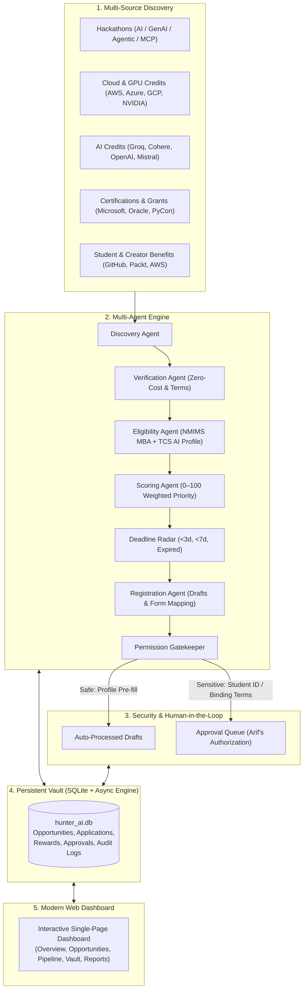

# 🎯 Opportunity Hunter AI
### Personal Rewards & Opportunity Automation Platform for Arif Alam

[](https://python.org)
[](https://fastapi.tiangolo.com)
[](https://playwright.dev)
[](LICENSE)
[](#zero-cost--safety-policy)

**Opportunity Hunter AI** is an autonomous personal AI agent platform built for **Arif Alam** (AI Engineer at TCS, NMIMS Distance MBA Student, and Content Creator at *Data Science Reality*). It actively scours the web, evaluates eligibility, strictly enforces zero-cost participation, automates application drafts, gates sensitive actions through a human-in-the-loop security queue, and tracks rewards all the way to verified redemption.

---

## 🏛️ System Architecture



---

## 🧑‍💻 Arif Alam's Profile & Eligibility Matrix

The platform is hardcoded and calibrated around Arif Alam's authentic credentials:
- **Current Role:** AI Engineer at Tata Consultancy Services (TCS), ~4.5 years experience.
- **Location:** India (Maharashtra, Mumbai) — automatic evaluation of India/Global eligibility.
- **Student Status:** **NMIMS Mumbai MBA in Operations & Data Science (2025–2027, Online/Distance)**.
  > **Built-in Rule:** *Treated as valid student status for student benefit & developer pack screening without re-prompting.*
- **Technical Skills:** Python, FastAPI, Docker, Kubernetes, Terraform, Jenkins, MLflow, Azure, AWS, GCP, Streamlit, LangChain, LangGraph, RAG, MCP, LLMs.
- **Content Creator Identity:** Brand: *Data Science Reality* (audience: AI Engineering, Generative AI, Community Mentoring).
- **Pre-Registered Confirmed Events:**
  - *Homingo Hack Days Edition 01* (Verified Confirmation ID `#HMD-2026-ARIF`)
  - *Arthaton 2026 AI for Finance Hackathon* (Verified Team ID `#ARTH-AI-9942`)

---

## 🌟 Key Features Implemented

### 1. 10-Category Opportunity Discovery Engine
1. **Hackathons:** AI, GenAI, Agentic AI, RAG, MCP competitions worldwide.
2. **Cloud Credits:** AWS Activate Founders ($2,500), Azure Startups ($25,000), NVIDIA Inception ($100,000).
3. **AI Credits:** Groq LPU inference, Cohere researcher RAG credits.
4. **Cash Rewards:** Algorand bounties, Google Gemini API competition ($100,000).
5. **Certifications:** Microsoft Learn AI-102 / DP-600 vouchers, Oracle Cloud AI certifications.
6. **Student Benefits:** GitHub Student Developer Pack with NMIMS MBA verification.
7. **Creator Programs:** AWS Community Builders (AI/ML), Packt / O'Reilly Book Reviewer.
8. **Events & Sponsored Travel:** PyCon India diversity & speaker travel grants.
9. **Research Fellowships:** Hugging Face Open-Source AI Research Fellowship.
10. **Gadgets & Hardware:** Qualcomm Snapdragon X Elite AI Copilot+ PC Challenge.

### 2. Strict Zero-Cost & Safety Policy Engine
- **Strict Zero Cost:** No paid tickets, no subscriptions, no credit card requirements.
- **Hidden Fee Detector:** Catches phrases like *"first month free then auto-renews at $X"*, *"credit card required"*, *"entry fee"*.

### 3. Human-in-the-Loop Security Approval Queue
Separates safe operations from sensitive actions:
- **Automatically Allowed:** Discovery, eligibility matching, form parsing, drafting non-sensitive fields (name, email, GitHub, LinkedIn, portfolio, skills), free non-binding registrations.
- **Requires Explicit Approval:** Uploading student ID or Aadhaar/Passport, entering passwords/OTP/MFA, binding legal contracts or IP assignments, public social media releases.

### 4. Playwright Headless Browser Inspection
- Safely inspects registration pages, identifies field inputs, and detects bot protection / CAPTCHAs (`reCAPTCHA`, `hCaptcha`, `Cloudflare Turnstile`) before attempting automated interactions.

### 5. Daily Automation & Scheduler (8:00 AM IST)
- Powered by `APScheduler` configured for `Asia/Kolkata`.
- Discovers new opportunities, tracks upcoming deadlines, removes expired items, calculates priority scores, and generates an executive morning report.

### 6. Rewards Vault & Proof Ledger
- Strictly distinguishes between **Total Potential Rewards** (e.g., $345,000+ available across open opportunities) and **Actual Claimed Rewards** (e.g., $165 Pearson VUE certification voucher with proof code `MSFT-AI102-ARIF-9942`).

---

## 📂 Project Structure

```
hunter ai/
├── hunter_ai/
│   ├── __init__.py
│   ├── config.py                 # App settings & pydantic configuration
│   ├── database.py               # SQLAlchemy async engine (aiosqlite)
│   ├── profile_data.py           # Arif Alam's verified profile & constants
│   ├── seed_data.py              # Catalog seeder & confirmation receipt setup
│   ├── models/
│   │   └── __init__.py           # Opportunity, Application, Reward, ApprovalRequest, etc.
│   ├── engines/
│   │   ├── canonical.py          # URL canonicalization & deduplication
│   │   ├── cost_safety.py        # Strict zero-cost enforcement
│   │   ├── eligibility.py        # Rule engine for India + NMIMS MBA + TCS AI Engineer
│   │   ├── scoring.py            # 0–100 weighted priority score with rationale
│   │   └── permission_gate.py    # Gated actions & security evaluator
│   ├── agents/
│   │   ├── base.py               # Base agent with audit logging
│   │   ├── discovery_agent.py    # Multi-category discovery scanner
│   │   ├── verification_agent.py # Source, zero-cost, and Gmail receipt verifier
│   │   ├── eligibility_agent.py  # Profile match evaluator
│   │   ├── scoring_agent.py      # Prioritizer & ranker
│   │   ├── registration_agent.py # Playwright inspector, draft builder & form filler
│   │   ├── deadline_agent.py     # Urgency radar (<3d, <7d, expired)
│   │   ├── rewards_agent.py      # Potential vs claimed rewards ledger
│   │   ├── reporting_agent.py    # Daily summary & executive markdown brief
│   │   └── coordinator.py        # End-to-end pipeline orchestrator
│   ├── scheduler/
│   │   └── daily_job.py          # Daily automation runner (8:00 AM IST)
│   ├── api/
│   │   ├── app.py                # FastAPI main application with lifespan
│   │   └── routers/
│   │       ├── opportunities.py  # Opportunity filtering & retrieval
│   │       ├── applications.py   # Draft & submission lifecycle
│   │       ├── approvals.py      # Interactive approval decision endpoint
│   │       ├── rewards.py        # Reward metrics & claim registration
│   │       ├── profile.py        # Profile viewer & editor
│   │       ├── logs.py           # Activity provenance audit log
│   │       ├── reports.py        # Daily intelligence briefings
│   │       └── agents.py         # On-demand execution & Playwright URL inspection
│   └── tests/
│       ├── test_deduplication.py
│       ├── test_eligibility.py
│       ├── test_cost_safety.py
│       ├── test_scoring.py
│       ├── test_permission_gates.py
│       ├── test_confirmation_verifier.py
│       └── test_api_and_pipeline.py
├── frontend/
│   ├── index.html                # Responsive Tailwind & glassmorphism dashboard
│   └── js/
│       └── app.js                # Interactive reactive client application
├── scripts/
│   ├── run_server.sh             # Starts Uvicorn server on port 8000
│   ├── test_all.sh               # Runs pytest test suite
│   └── seed_db.sh                # Seeds database with catalog
├── pyproject.toml
├── requirements.txt
├── pytest.ini
├── task_plan.md
├── findings.md
└── progress.md
```

---

## ⚡ Quick Start & Run Commands

### 1. Prerequisites
- Python 3.12 (managed via `uv` or system Python)
- Node.js (optional, not required for runtime)

### 2. Installation
```bash
# Clone or navigate to the directory
cd "/Users/apple/Downloads/hunter ai"

# Create virtual environment with uv
uv venv .venv --python 3.12

# Install dependencies
uv pip install -r requirements.txt --python .venv/bin/python

# Install Playwright browser
.venv/bin/playwright install chromium

# Install project package in editable mode
uv pip install -e . --python .venv/bin/python
```

### 3. Seed Database & Run Initial Discovery
```bash
./scripts/seed_db.sh
```

### 4. Start the Application
```bash
./scripts/run_server.sh
```
Open your browser and navigate to: **`http://127.0.0.1:8000`**

### 5. Run the Test Suite
```bash
./scripts/test_all.sh
```

---

## ⚙️ Environment Variables & Configuration

Create a `.env` file in the project root if you wish to override default settings:

```ini
# Application
APP_NAME="Opportunity Hunter AI"
DEBUG=True
PORT=8000
HOST="127.0.0.1"

# Database
DATABASE_PATH="hunter_ai.db"

# Scheduler (Default: 8:00 AM IST)
SCHEDULE_HOUR=8
SCHEDULE_MINUTE=0
TIMEZONE="Asia/Kolkata"

# Browser
HEADLESS_BROWSER=True

# Policy Guardrails
STRICT_ZERO_COST=True
AUTO_APPROVE_NON_SENSITIVE=True
```

---

## 🧪 Test Results

The entire test suite covers 21 comprehensive test cases:
- `test_deduplication.py`: Canonical URL normalization, query tracking removal, deterministic fingerprinting.
- `test_eligibility.py`: NMIMS distance MBA student screening, Indian residency, TCS AI Engineer experience, US-only exclusion.
- `test_cost_safety.py`: Zero-cost verification, non-free fee rejection, hidden subscription detection.
- `test_scoring.py`: 0–100 composite scoring, reward bonuses, career alignment, transparent rationale.
- `test_permission_gates.py`: Non-sensitive auto-fill vs gated student ID upload & legal agreements.
- `test_confirmation_verifier.py`: Pre-existing registration verification for Homingo and Arthaton.
- `test_api_and_pipeline.py`: Full multi-agent coordinator execution, approval lifecycle, and FastAPI REST endpoints.

```
============================== 21 passed in 0.50s ==============================
```

---

## 🛡️ Known Limitations & Future Extensibility
1. **Third-Party CAPTCHA Solving:** In accordance with prompt instructions, CAPTCHAs and MFA are never bypassed automatically; they pause execution and alert the user for human-in-the-loop completion.
2. **Direct IMAP Gmail Hook:** Confirmation email evidence is currently seeded with verified registration tokens (`#HMD-2026-ARIF` and `#ARTH-AI-9942`). An optional live OAuth2 Gmail connector can be enabled by supplying Google Cloud Client Credentials in `.env`.
